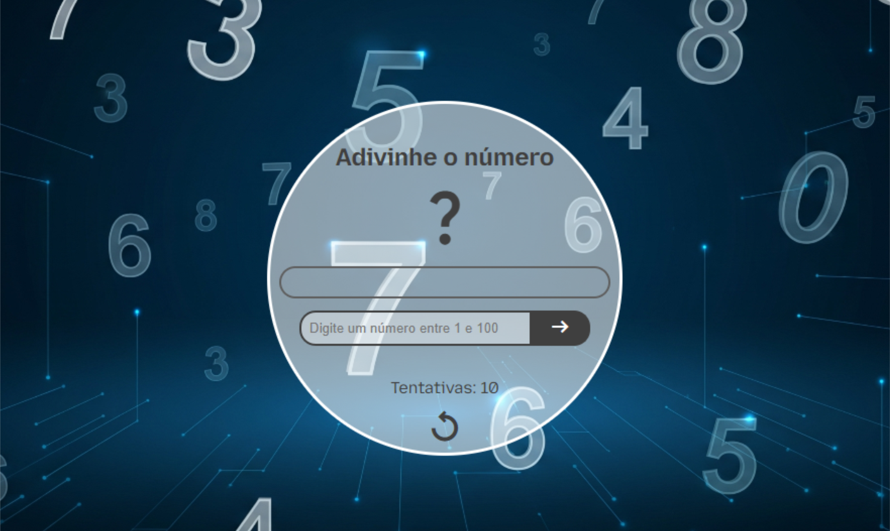

# 🎮 Number Guessing Game

A personal implementation of the Number Guessing Game featured in the [MDN Web Docs JavaScript tutorial](https://developer.mozilla.org/en-US/docs/Learn_web_development/Core/Scripting/A_first_splash), created to practice fundamental web development concepts.

## 📖 About the Project

Number Guessing Game is a simple browser game in which the player must guess a randomly generated secret number between 1 and 100.

After each guess, the game provides feedback indicating whether the guess was too high or too low. The player has up to 10 attempts to find the correct number.

This project was developed as a learning exercise to practice HTML, CSS, and JavaScript through an interactive application.

## ✨ Features

- Random number generation between 1 and 100.
- A maximum of 10 attempts per game.
- Feedback indicating whether a guess is too high or too low.
- Display of previous guesses.
- Input validation and feedback for invalid or repeated guesses.
- Win and lose states with appropriate messages.
- Option to start a new game without reloading the page.

## 🖼️ Preview



## 💻 Technologies Used

- **HTML5:** Provides the structure and markup of the application.
- **CSS3:** Handles styling, layout, responsive design, and visual effects.
- **JavaScript:** Implements the game logic, input validation, attempt tracking, and DOM manipulation.

## 📂 Project Structure

```text
adivinhe-o-numero/
├── src/
│   ├── css/
│   │   └── style.css
│   ├── images/
│   │   ├── background.png
│   │   ├── favicon.png
│   │   └── preview.png
│   └── script/
│       └── script.js
├── index.html
├── LICENSE
└── README.md
```

## 🚀 Getting Started

### Play Online

Access the deployed application through GitHub Pages:

[**Play Number Guessing Game**](https://charlesson-mp.github.io/adivinhe-o-numero/)

### Run Locally

1. Clone the repository:

   ```bash
   git clone https://github.com/Charlesson-MP/adivinhe-o-numero.git
   ```

2. Navigate to the project directory:

   ```bash
   cd adivinhe-o-numero
   ```

3. Open `index.html` in your browser.

No additional dependencies or build tools are required.

## 🔮 Future Improvements

- [ ] Disable the submit button when the input is empty or invalid.
- [ ] Improve duplicate-guess detection to handle numeric values reliably.
- [ ] Ensure that winning on the final attempt is handled correctly.
- [ ] Improve accessibility through keyboard navigation, focus indicators, and accessible feedback messages.
- [ ] Review the responsive layout on smaller screens.
- [ ] Optimize image assets to reduce loading times.

## 📚 Learning Reference

This project was inspired by the **Number Guessing Game** exercise in the MDN Web Docs tutorial, [A first splash into JavaScript](https://developer.mozilla.org/en-US/docs/Learn_web_development/Core/Scripting/A_first_splash).

The implementation was developed independently as a personal learning project.

## 📄 License

This project is distributed under the license specified in the [`LICENSE`](./LICENSE) file.
